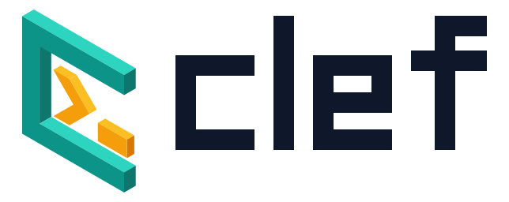
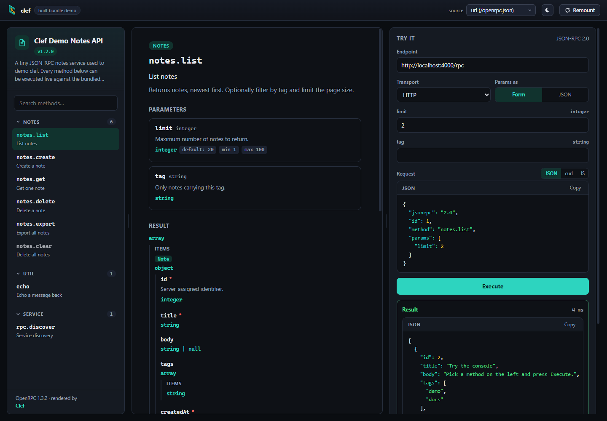

<div align="center">

<picture>
  <source media="(prefers-color-scheme: dark)" srcset="assets/clef-horizontal-white.svg">
  
</picture>

**The only clef to your JSON-RPC backend. Your OpenRPC spec, direct — no OpenAPI casting.**

Methods, schemas and errors render exactly as written, and every method executes right from the docs — over HTTP or WebSocket, with ready-made curl and JS snippets. Svelte 5 inside, one self-contained file outside (~44 KB gzip): no React, no MUI, no runtime dependencies.

</div>

<p align="center">
  
</p>

## Quick start

One `<script>` tag gives you both the `clef.mount` function and the `<clef-docs>` element:

```html
<script src="https://cdn.jsdelivr.net/npm/@chord-ts/clef"></script>
<div id="docs" style="height: 100vh"></div>
<script>
  clef.mount('#docs', { url: '/openrpc.json', endpoint: '/rpc' });
</script>
```

Or declaratively, with no JS on the page:

```html
<clef-docs url="/openrpc.json" endpoint="/rpc" theme="auto" style="display: block; height: 100vh"></clef-docs>
```

With a bundler: `npm install @chord-ts/clef`, then `import { mount } from '@chord-ts/clef'`. Public API types are included.

In a Svelte app, use the component (`svelte ^5` is an optional peer):

```svelte
<script lang="ts">
  import { Clef } from '@chord-ts/clef/svelte';
  let options = $state({ url: '/openrpc.json', endpoint: '/rpc' });
</script>

<Clef {options} />
```

Options are reactive: change fields or replace the whole object and the widget updates without reloading the document.

clef is not on npm yet. Until the first release, serve `dist/clef.iife.js` from this repository — the example pages fall back to it automatically.

## Options

| Option | What it does |
| --- | --- |
| `spec` | OpenRPC document as an object or JSON string — inline, no fetch and no CORS |
| `url` | URL of the document; clef fetches it itself |
| `endpoint` | JSON-RPC endpoint: the spec is pulled via `rpc.discover` and the address is used in Try it |
| `transport` | `'http'` (default) or `'websocket'`; for WS, `http(s)://` is rewritten to `ws(s)://` automatically |
| `theme` | `'auto'` (default), `'light'` or `'dark'` |
| `tryIt` | `false` hides the console, leaving documentation only |
| `requestTimeoutMs` | request timeout, 15000 by default |
| `icon` | logo URL for the sidebar header; falls back to `info.x-logo.url` from the spec, then to a neutral document icon |

The spec source is chosen by priority: `spec` → `url` → `endpoint`. The widget fills its container's height (480px minimum), so give the container an explicit height.

On narrow screens (≤900px) the columns become three swipeable panels: methods, documentation, Try it. A sidebar-icon button in the docs header jumps left to the method list, a “Try it” button jumps right to the console, and horizontal swipes move between panels as well.

`mount()` returns a handle: `update(options)` replaces options on the fly, `destroy()` removes the widget. `<clef-docs>` takes the same settings as attributes (`url`, `endpoint`, `transport`, `theme`, `try-it`, `icon`, `spec` — a JSON string); an object spec can also be set via the `element.spec` property.

## Demo

```bash
pnpm demo:server
```

Starts a mock JSON-RPC server at http://localhost:4000 with a page built on the bundled file: switch spec sources (url / rpc.discover / inline / web component) and themes. Every method in the demo spec really executes, including over WebSocket.

For development with HMR: `pnpm dev` → http://localhost:5173/demo/ (the demo server must be running).

## Examples

`examples/` holds minimal pages with the same scenario, differing only in how clef is loaded:

| Page | Loading |
| --- | --- |
| `/examples/component.html` | declarative: the `<clef-docs>` element |
| `/examples/bundle.html` | own bundle: the file from the npm package, or `import { mount } from '@chord-ts/clef'` in a bundler |
| `/examples/cdn.html` | one `<script>` tag from jsDelivr + `clef.mount` |
| `/examples/svelte/` | the `<Clef>` component from `@chord-ts/clef/svelte` |

Open the HTML pages through the demo server: `pnpm demo:server` → http://localhost:4000/examples/cdn.html (and the others). While the package is unpublished, CDN pages fall back to the built `dist/` locally. The Svelte example needs a build: `pnpm build`, then `pnpm dev` → http://localhost:5173/examples/svelte/.

## Development

```bash
pnpm install
pnpm test     # vitest: core + mount() integration in jsdom
pnpm check    # svelte-check
pnpm build    # dist/clef.iife.js + dist/clef.esm.js + types
```

The core (`src/core`) does not depend on Svelte: the spec loader, `$ref` resolution, the JSON-RPC client and example generation from JSON Schema are tested separately from the UI. Components (`src/components`) use Svelte 5 runes; styles are inlined into the bundle at build time.

The brand kit (symbol, lockup, mono versions, favicons and app icons) lives in `assets/` and is copied to `dist/assets/` at build time, so it ships inside the npm package alongside the bundle. Usage rules: `logo/GUIDELINES.md`.

## Limitations

- JSON specs only; YAML is not supported.
- `$ref` resolves internal references (`#/components/...`) only; external links are not fetched.
- Descriptions render as plain text, without Markdown.
- The WebSocket transport opens a separate connection per request.
- Cross-origin Try it requests require CORS headers on the endpoint.

## License

MIT